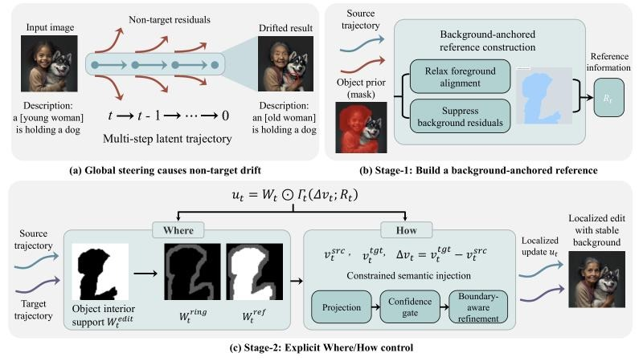

# OAVC: Object-Aware Background-Controlled Editing via Weighted Velocity Guidance

Official implementation of **Object-Aware Velocity Control (OAVC)**, a training-free method for text-guided image and video editing with rectified-flow models.

> **Object-Aware Background-Controlled Editing via Weighted Velocity Guidance**
> Wuji Wang, Yue Wu, Chenhao Yi, Shuhui Wang
> [arXiv:2609.06288](https://arxiv.org/abs/2609.06288)

<p align="center">
  
</p>

OAVC controls **where** and **how** the edit is injected. Stage 1 builds a background-anchored reference under the source prompt. Stage 2 injects the target-prompt velocity change only inside an object support (from SAM3), with a time-varying boundary ring, a constrained (projected) injection, a confidence gate and a boundary high-pass. It works with Stable Diffusion 3.5, FLUX.1-dev and Wan2.1.

## Installation

```bash
conda create -n oavc python=3.10 -y
conda activate oavc
pip install -r requirements.txt
```

Install [SAM3](https://github.com/facebookresearch/sam3) and download `sam3.pt`.

Expected layout (all commands are run from the repository root):

```
checkpoints/
├── stable-diffusion-3.5-medium/
├── FLUX.1-dev/
├── sam3/sam3.pt
└── Wan2.1-T2V-1.3B/              # video only
data/
├── PIE/                          # PIE-Bench: annotation_images/, mapping_file.json
└── DAVIS/                        # DAVIS 2017 480p: JPEGImages/, Annotations/ (video only)
```

## Image editing on PIE-Bench

**1. Compute SAM3 object supports** (once per image, cached)

```bash
bash scripts/precompute_masks.sh
```

**2. Run OAVC**

```bash
bash scripts/run_sd35.sh     # Stable Diffusion 3.5
bash scripts/run_flux.sh     # FLUX.1-dev
```

All hyper-parameters default to the values in the paper (λ_fg = 0.6, ρ_bg = 0.1, r_fg = 2, r_bd = 4, β_max = 0.45). Sampler settings (steps, start step, CFG, MVG) are in `configs/`. Use `--only_ids 000000000000,000000000001` to run a few samples.

**3. Evaluate**

```bash
bash scripts/evaluate.sh outputs/oavc_sd35
```

This computes Structure Distance, background PSNR / LPIPS / MSE / SSIM and CLIP similarity following the PIE-Bench protocol.

## Video editing on DAVIS (Wan2.1)

```bash
bash video/scripts/run_bear_to_panda.sh
```

Scripts for the four DAVIS sequences are in `video/scripts/`. The object support comes from the DAVIS ground-truth masks. Background metrics (BG-PSNR, BG-L1 and their flow-warped versions) are computed with `video/eval_davis_temporal_metrics.py`.

## Acknowledgements

OAVC is built on [DNAEdit](https://github.com/xiechenxi99/DNAEdit_code). The video code is built on [Wan2.1](https://github.com/Wan-Video/Wan2.1) (Apache-2.0, see `video/wan/LICENSE.txt`). Object supports use [SAM3](https://github.com/facebookresearch/sam3), and evaluation follows [PIE-Bench](https://github.com/cure-lab/PnPInversion). We thank the authors for releasing their code.

## Citation

```bibtex
@article{wang2026oavc,
  title   = {Object-Aware Background-Controlled Editing via Weighted Velocity Guidance},
  author  = {Wang, Wuji and Wu, Yue and Yi, Chenhao and Wang, Shuhui},
  journal = {arXiv preprint arXiv:2609.06288},
  year    = {2026}
}
```
